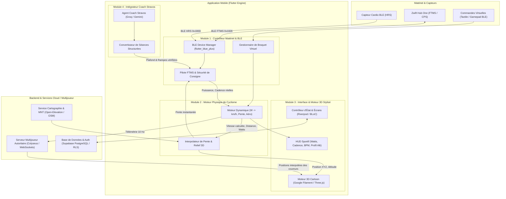

# Architecture Globale — Plateforme Fogcycling

## 1. Vue d'Ensemble
Fogcycling est structuré selon une architecture modulaire en couches, garantissant une séparation stricte entre le sous-système de contrôle matériel (Bluetooth BLE/FTMS), le moteur physique de simulation, le pipeline de rendu graphique 3D stylisé, le moteur d'intelligence artificielle (Coach Stravos) et le backend multijoueur autoritaire.

---

## 2. Décomposition des 10 Modules Fonctionnels

### Module 1 : Application Mobile & Couche Présentation
- Interface tactile ergonomique pour cockpit de vélo (smartphone posé sur guidon).
- HUD haute lisibilité (chiffres contrastés de grande taille : Watts, Fréquence Cardiaque, Cadence, Vitesse, Pente %, Dénivelé restant).
- Gestion des états (déconnexion, mise en pause, reprise d'effort sans perte de données).

### Module 2 : Interface & Moteur 3D Stylisé (Cartoon / Cel-Shading)
- Rendu 3D temps réel à 60 images par seconde optimisé pour smartphones milieu et haut de gamme.
- Direction artistique originale : routes stylisées, environnement coloré (arbres low-poly, nuages animés, spectateurs stylisés, banderoles de col).
- Cycliste animé : cadence de pédalage proportionnelle aux RPM réels reçus par BLE, inclinaison du vélo dans les virages, animation de danseuse en côte (>8% ou puissance >150% FTP).

### Module 3 : Gestionnaire Bluetooth BLE & Smart Trainer
- Scan, détection et appairage automatique des périphériques.
- Support strict des spécifications Bluetooth SIG :
  - **FTMS (Fitness Machine Service, 0x1826)**.
  - **CPS (Cycling Power Service, 0x1818)**.
  - **CSCS (Cycling Speed and Cadence Service, 0x1816)**.
  - **HRS (Heart Rate Service, 0x180D)**.
- Reconnexion automatique instantanée en arrière-plan en cas de micro-coupure BLE.

### Module 4 : Moteur Physique de Cyclisme
Modélisation dynamique rigoureuse calculée à chaque frame (60 Hz) selon l'équation fondamentale de l'effort cycliste :

$$P_{\text{mécanique}} = P_{\text{roulement}} + P_{\text{gravité}} + P_{\text{aérodynamique}} + P_{\text{accélération}} + P_{\text{transmission}}$$

Où :
- $P_{\text{gravité}} = m_{\text{total}} \cdot g \cdot \sin(\theta) \cdot v$ avec $m_{\text{total}} = m_{\text{cycliste}} + m_{\text{vélo}}$, $g = 9.81 \, \text{m/s}^2$ et $\theta = \arctan(\text{pente})$.
- $P_{\text{roulement}} = m_{\text{total}} \cdot g \cdot \cos(\theta) \cdot C_{rr} \cdot v$ ($C_{rr} \approx 0.004$ pour pneu course sur asphalte virtuel).
- $P_{\text{aérodynamique}} = \frac{1}{2} \cdot \rho \cdot C_d A \cdot (v + v_{\text{vent}})^2 \cdot v$ ($\rho = 1.225 \, \text{kg/m}^3$ au niveau de la mer, $C_d A \approx 0.32 \, \text{m}^2$ standard).
- $P_{\text{accélération}} = m_{\text{total}} \cdot v \cdot \frac{dv}{dt}$.
- $P_{\text{transmission}} = \eta \cdot P_{\text{développée}}$ (avec un rendement de chaîne $\eta \approx 0.975$).

À partir de la puissance réelle $P$ injectée par le Zwift Hub, le moteur résout numériquement la vitesse $v(t)$ et la distance parcourue $d(t)$.

### Module 5 : Importation et Conversion des Parcours Réels
- Parseur de fichiers GPX/FIT standard.
- Calcul de distance géodésique par formule de Haversine.
- Lissage altimétrique par filtre Savitzky-Golay ou moyenne mobile (suppression du bruit GPS et des à-coups de dénivelé).
- Génération procédurale du ruban de route 3D via des courbes Catmull-Rom ou B-Splines.

### Module 6 : Gestion des Entraînements & Mode ERG
- Moteur d'exécution de séances par paliers temporels.
- Asservissement en boucle fermée de la consigne de puissance (Mode ERG FTMS `0x2AD9` avec opcode `0x05`).
- Boutons d'ajustement dynamique de l'intensité (+5% / -5%) en cours d'effort.

### Module 7 : Intégrateur Coach Stravos IA
- Connexion aux moteurs LLM (Groq Llama 3.3 70B / Google Gemini Flash 1.5/2.0).
- Contrat d'interface strict JSON : la recommandation IA est sérialisée en schéma typé avant toute exécution.
- **Principe d'isolation absolue** : Le LLM n'a aucun accès direct au bus Bluetooth. Toutes les puissances cibles sont bornées par le contrôleur de sécurité matériel.

### Module 8 : Courses et Sessions Multijoueurs
- Moteur multijoueur basé sur **Colyseus** (WebSockets temps réel).
- Architecture autoritaire : le client transmet son triplet $(P, Cadence, Timestamp)$, le serveur valide l'intégrité physique de la vitesse et répercute la position aux autres participants dans la "Room" du parcours.
- Interpolation d'entités (Client-side Prediction & Dead Reckoning) pour une fluidité parfaite à 60 FPS malgré la latence réseau.

### Module 9 : Backend, Comptes et Base de Données
- Plateforme **Supabase** (PostgreSQL managé) :
  - Authentification sécurisée (Email/Mot de passe, Magic Link).
  - Politiques RLS (Row Level Security) garantissant qu'un utilisateur ne peut accéder qu'à ses propres données sportives.
  - Synchronisation des profils, FTP, poids, historiques d'activités (.FIT).

### Module 10 : Administration, Sécurité et Observabilité
- Tableau de bord d'administration protégé (rôle `admin` vérifié par JWT cryptographique côté serveur).
- Modération des courses, gestion des parcours officiels, monitoring de santé des services.
